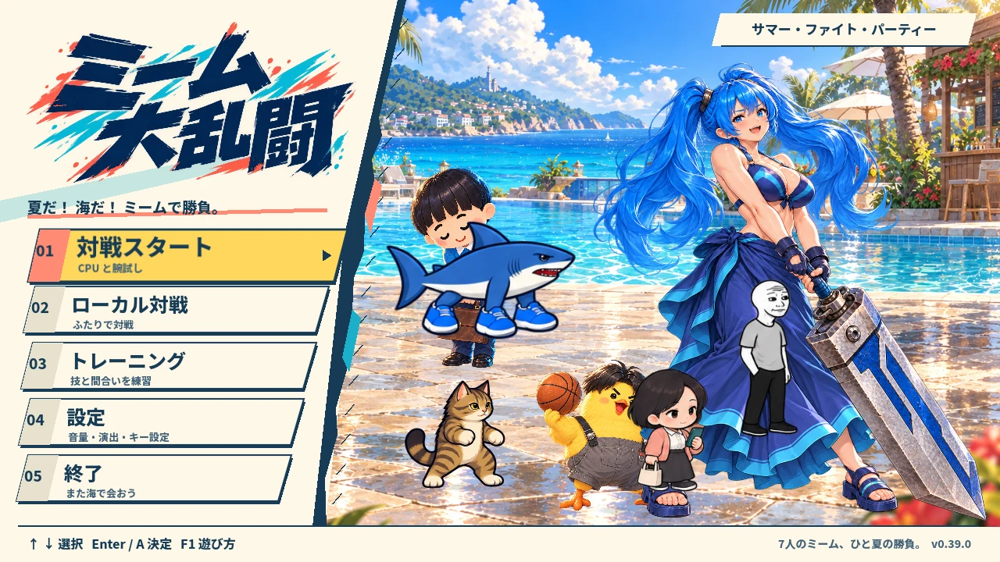
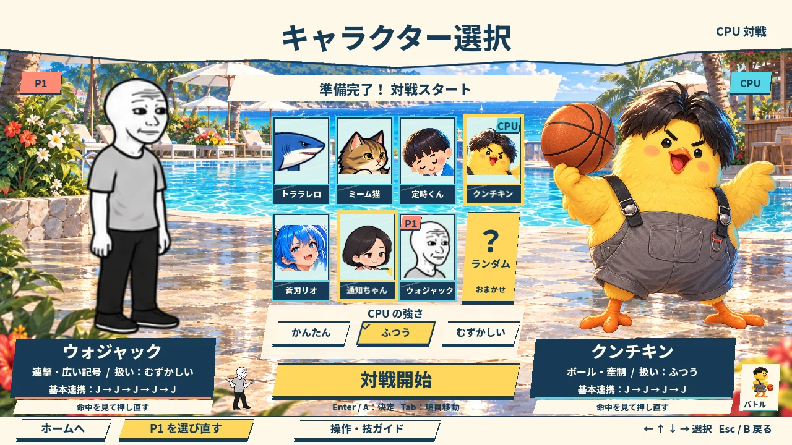
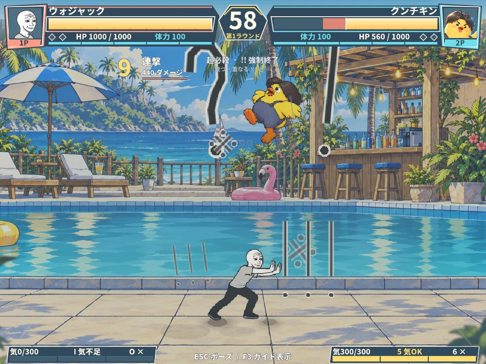

# ミーム大乱闘 — MEME CLASH

7人のミームキャラクターで、連続技とド派手な必殺技をつなぐ2D対戦アクション。Godotで制作中の無料デモ **v0.39.0** です。

[**ブラウザで遊ぶ / Play on itch.io**](https://kashin-ou.itch.io/meme-clash) · [**作品紹介 / Portfolio**](https://kashin.ink/works/meme-clash) · [**Releases**](https://github.com/kash1n-tianxie/meme-clash/releases)



## 遊べる内容

- ミーム猫、定時くん、クンチキン、トララレロ、蒼刃リオ、通知ちゃん、ウォジャックの7人。
- 各キャラクター8種類、合計56種類のスキル・必殺技。地上・方向入力・空中で技が変わります。
- 3段階のCPU対戦、同じPC・キーボードで遊ぶローカル2人対戦、トレーニング。
- 防御、瞬歩、受け身、命中時の停止、必殺カットイン。
- ウォジャックは「？」「！」などの記号、定時くんは書類と承認印で攻撃します。

日本語UI。**PCとキーボードで遊んでください。** 初回は約500 MBを読み込むため、回線によって数分かかります。タッチ操作による対戦には対応していません。制作中のため、動作速度や表示はブラウザ・端末によって変わります。

| キャラクター選択 | ウォジャックの必殺技 |
| --- | --- |
|  |  |

## 操作

読み込み後にゲーム画面をクリックしてください。Enterで決定、Escで戻る・一時停止します。

| 操作 | 1P | 2P |
| --- | --- | --- |
| 左右移動 | A / D | ← / → |
| 上方向 | W | ↑ |
| 防御・下方向 | S | ↓ |
| 通常攻撃 | J | 1 |
| ジャンプ | K | 2 |
| 瞬歩 | L | 3 |
| スキル | U | 4 |
| 必殺技 | I | 5 |
| 被ダメージ中の脱出 | O | 6 |

W / S + J・U・Iで方向派生、空中U・Iで空中技。S + I（2Pは↓ + 5）は気300の大必殺技です。技や脱出には気・状態などの使用条件があります。通常攻撃はタイミングを見て押し直すと連携します。

ホーム画面のF1、対戦中のポーズメニューから操作・技のガイドを確認できます。設定画面でキー変更が可能です。トレーニングではRで位置リセット、Tで練習相手の防御を切り替えます。

## ソースから実行

1. このリポジトリを取得します。ゲームに必要な画像・音声・フォントも含まれています。
2. **Godot 4.7.1 Standard（.NET不要）** で `project.godot` を開きます。
3. 初回インポートの完了後、**F5** でプロジェクトを実行します。

```sh
git clone https://github.com/kash1n-tianxie/meme-clash.git
cd meme-clash
godot --editor --path .
```

### Web版のビルド

Godot 4.7.1と同じバージョンの公式エクスポートテンプレート、およびPython 3を用意します。

```sh
godot --headless --path . --import
mkdir -p ../build/web
godot --headless --path . --export-release Web ../build/web/index.html
python3 tools/split_web_pack.py ../build/web
python3 -m http.server 8000 --directory ../build/web
```

`http://localhost:8000` を開いてください。`index.html` の直接起動（`file://`）は使えません。単一スレッドのWeb出力です。リソースを分割するスクリプトが生成したファイルは、すべて同じフォルダに配置してください。詳細は [README-PUBLIC.md](README-PUBLIC.md) を参照してください。

Releasesの `meme-clash-v0.39.0-web.zip` はitch.ioと同じビルドです。展開後に上記と同様のHTTPサーバーで配信できます。GitHub上のソースには、公開用の説明と画像を追加し、本機の制作パスなどのメタデータを整理しています。

## 制作・ライセンス

企画・制作：**王家進 / Kashin Ou**。実装と素材制作にAIによる支援を使用しています。掲載画像は実機キャプチャです。

ゲームコードは [5DPLAY Game Studio / BleachVsNaruto](https://github.com/5DPLAY-Game-Studio/BleachVsNaruto) の公開コードから一部を移植・統合しており、結合された派生コードは **GPL-3.0-or-later** です。原作のSWF、キャラクター画像、マップ画像、音楽、音声は同梱していません。独立した制作プロジェクトです。

- [GPLライセンス](LICENSE) / [上流の告知](NOTICE-BVN.txt) / [移植記録](SOURCE_REFERENCES.txt)
- Godot Engine：MIT（[LICENSES.txt](LICENSES.txt)、[GODOT-COPYRIGHT.txt](GODOT-COPYRIGHT.txt)）
- Noto Sans JP：SIL OFL（[assets/fonts/OFL.txt](assets/fonts/OFL.txt)）

---

**English:** MEME CLASH is an in-development 2D fighting game with seven meme characters, CPU battles, shared-keyboard local versus, and training. The game interface is Japanese. Use a desktop browser and keyboard; the first download is about 500 MB. Open `project.godot` in Godot 4.7.1 to run the source, or use the Web build instructions above. See [README-PUBLIC.md](README-PUBLIC.md) for English controls and build details.
